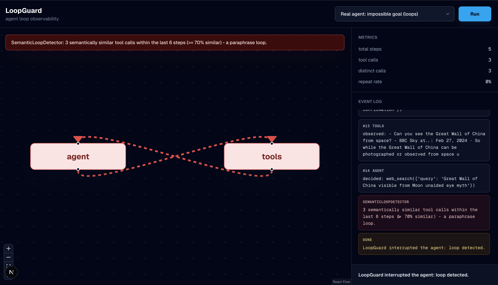

# LoopGuard

[](https://pypi.org/project/loopguard-runtime/)
[](https://pypi.org/project/loopguard-runtime/)
[](https://pypi.org/project/loopguard-runtime/)

[](docs/index.mdx)
[](https://pypi.org/project/loopguard-runtime/)
[](https://youtu.be/i5XRrvFoPA0)
[](https://github.com/mahimathacker/loopguard)

**Runtime guardrails for AI agents that detect loops, repeated failures, and runs that stop making progress.**

```text
same tool + useful new result   -> continue
same tool + same empty result   -> stop
503 -> 503 -> success           -> continue
401 -> 401 -> 401               -> stop
```

## Why LoopGuard

Agents can keep spending time and tokens without getting closer to an answer.
LoopGuard watches LangGraph and LangChain runs and checks repeated actions against
results, progress, and failures. Useful polling can continue; repeated empty results
can provide evidence to stop.

It complements your agent and tracing tools by turning recorded behavior into runtime
decisions. The examples above illustrate patterns; thresholds and evidence determine
the actual decision.

## See it in action

[](https://youtu.be/i5XRrvFoPA0)

An agent keeps searching for an impossible confirmation. LoopGuard flags repeated
intent and interrupts the demo. This repository capture shows an earlier UI layout.

[Watch the demo](https://youtu.be/i5XRrvFoPA0) ? [Run it locally](docs/demo/running-locally.mdx)

## Quick example

**Prerequisites:** Python 3.11+ and pip. This integration assumes an existing
LangGraph/LangChain agent and its framework dependencies.

```bash
pip install loopguard-runtime
```

The package is `loopguard-runtime`; the import is `loopguard`. With your existing
`agent` and `my_input`:

```python
from loopguard import LoopGuardCallbackHandler, LoopGuardInterrupt

handler = LoopGuardCallbackHandler()
handler.raise_error = True

try:
    result = agent.invoke(my_input, config={"callbacks": [handler]})
except LoopGuardInterrupt as exc:
    print("LoopGuard stopped the run:", exc)

print(handler.report())
```

LangChain must propagate callback errors, and the agent's tool-error handling must
let `LoopGuardInterrupt` escape. Use `interrupt_on_fatal=False` to collect reports
without raising. `REPLAN` and `PAUSE` are recorded recommendations today.

[Run a complete example without a model or API key ?](docs/getting-started.mdx)

## What it detects

| Pattern | Evidence |
| --- | --- |
| Exact and semantic loops | Repeated calls or repeated intent in different words. |
| Stalls and no progress | Unchanged, empty, or error-like tool results. |
| Repeated failures | Retryable errors versus likely permanent failures. |
| Action and handoff cycles | Repeating sequences or closed multi-agent handoffs. |
| Budget overruns | Configurable limits on recorded steps and tool calls. |

[Detection](docs/detection.mdx) ? [Configuration](docs/guides/configuration.mdx)

## How it works

```text
Agent event -> Tracer -> Detectors -> Signals -> Policy -> Decision
```

Repetition alone can warn; repetition plus no progress can stop. The policy combines
signals into `CONTINUE`, `WARN`, `REPLAN`, `PAUSE`, or `STOP`.

[How LoopGuard works ?](docs/how-it-works.mdx)

## Live runs and saved traces

Use callbacks during a live run, or inspect an exported trace without rerunning the
agent. From a repository checkout:

```bash
python -m loopguard.ingest examples/sample_trace.json
python -m loopguard.check examples/sample_trace.json
```

`ingest` reports findings; `check` gives pass/fail behavior for scripts or CI.
The sample includes a loop, so its check exits with code `1`.

[Integration guide](docs/guides/integration.mdx) ? [Saved traces](docs/guides/saved-traces.mdx)

## Demo scenarios

Compare offline exact loops, paraphrased searches, healthy polling, temporary 503
recovery, permanent 401 failures, empty results, and real calculation/search agents.
Only `exact` runs without provider credentials; other scenarios need a model,
embeddings, or both.

[Scenario walkthroughs ?](docs/demo/scenarios.mdx)

## Evaluation

The core suite uses fake agents and embeddings and runs offline:

```bash
python -m unittest discover -v
```

The repo also includes labeled progress-aware traces and a small detector evaluation
harness. [Evaluation and its limits ?](docs/development/evaluation.mdx)

## Documentation

**Hosted documentation:** [DOCS URL TO ADD AFTER DEPLOYMENT]

The [Mintlify source](docs/index.mdx) covers the full developer journey.
See [preview and deployment instructions](docs/README.md),
[troubleshooting](docs/troubleshooting.mdx), or the [Python API](docs/reference/python.mdx).

## Package and project status

[loopguard-runtime v0.2.1](https://pypi.org/project/loopguard-runtime/0.2.1/) is an alpha
release. Python 3.11+ is required; package classifiers list 3.11 and 3.12.
Gemini support and controlled demo scenarios currently require the source checkout.
JavaScript support and GitHub check annotations remain roadmap ideas.

[Status and roadmap](docs/development/status.mdx) ? [Report an issue](https://github.com/mahimathacker/loopguard/issues)
