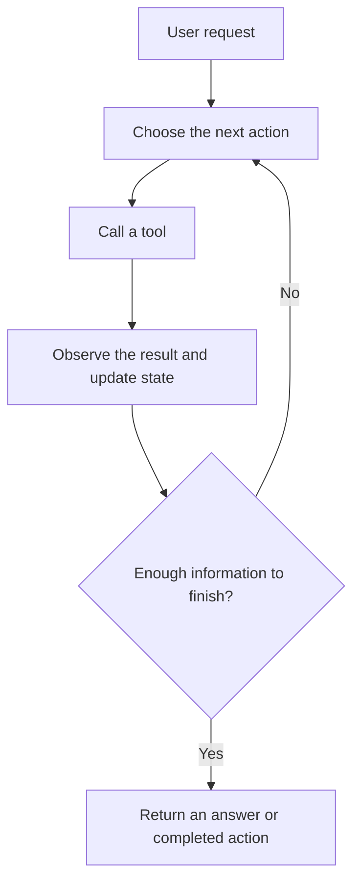

An AI agent can choose an action, use a tool, inspect the result, and decide what
to do next. That cycle lets it work on tasks that need more than one model response.
It also creates opportunities to repeat work without getting closer to the goal.

The question is not simply whether the agent loops. The question is whether each
trip around the loop adds something useful.

## What an agent is made of

Consider a user asking, "Show me last month's sales trend." The agent might select
a database tool, fetch the data, calculate a comparison, and write an explanation.

| Part | What it does | A question to ask when debugging |
| --- | --- | --- |
| Decision or routing logic | Chooses the next action or workflow. | Did it choose the right tool for this request? |
| Tools | Execute calls such as queries, searches, and calculations. | Did the tool receive the right arguments and return useful data? |
| State | Carries results and execution details within the run. | Did the next action use the result that just came back? |
| Memory | Makes earlier context available when the application needs it. | Was that context relevant and current? |
| Completion logic | Decides when to answer, stop, or ask for help. | Was the task finished, or did the agent only run out of steps? |

These are responsibilities, not a required architecture. A model can choose tools
without a separate router component. Some applications use explicit routing rules;
others combine several responsibilities in one graph node. A skill can also be a
larger workflow built from several tools rather than one callable function.

## The normal agent loop



An execution trace records the visible path through this cycle. It can show tool
selection and returned results; it does not automatically reveal a model's private
reasoning or every piece of application state.

## Repetition can be useful

Polling, retries, and pagination all repeat work for a reason:

| Pattern | Example | Evidence of useful progress |
| --- | --- | --- |
| Polling | Check a job until it completes. | `pending -> processing -> completed`. |
| Retry | Retry after a temporary service failure. | A short failure sequence is followed by success. |
| Pagination | Fetch successive result pages. | The cursor or page advances and new records arrive. |

A repeated tool name is not enough to label any of these runs as stuck. Even the
same arguments can be reasonable when a remote job is still changing state.

Some useful work also returns an unchanged status for a while. Progress detection
needs settings that reflect how the application behaves, not just a universal
repeat limit.

## When the loop becomes a problem

A run becomes suspicious when repeated activity no longer produces useful evidence
or a different approach:

```text
search("pricing page") -> no results
search("pricing page") -> no results
search("pricing page") -> no results
```

Changing the wording does not always change the approach:

```text
search("pricing page")  -> no results
search("current prices") -> no results
search("pricing details") -> no results
```

An agent can also alternate actions, repeatedly encounter a permanent failure, or
pass work around a closed multi-agent cycle. Other stalled runs never repeat one
exact action; they just keep receiving empty or unhelpful results.

These patterns point to different problems. The agent might not use previous tool
results, its context might be stale, the task might be impossible, or a service
failure might require human action. Detecting the pattern helps you locate the
problem; it does not identify the cause with certainty.

## Progress is evidence, not proof of success

Changing output can suggest progress, but new text can still be irrelevant.
Repeated output can suggest a stall, but a long-running job might legitimately
return the same status. Task completion needs application-specific criteria.

LoopGuard's default detectors use normalized actions, result comparisons, and
text heuristics. Optional embeddings add evidence about repeated intent. The
policy combines that evidence into a runtime recommendation or stop decision.

LoopGuard does not check whether the sales query used the correct table, whether
the calculation answered the user's question, or whether a final answer is grounded.
Those need other evaluations alongside the stuck-run checks.

## Put a bound on the work

An agent needs a way to finish, and a way to stop when finishing isn't happening.
That may mean an explicit completion condition, a request for user input, a run
budget, or a guardrail that interrupts repeated failures.

LoopGuard can enforce recorded-event and tool-call budgets and raise a stop
exception through its callback integration. `REPLAN` and `PAUSE` remain recorded
recommendations; the application must implement the response to those actions.

Use the [four visual SDK examples](/demo/scenarios#run-the-visual-examples-through-the-sdk)
to compare these patterns, or read [detecting stuck agents](/detection) for the
specific evidence each detector collects.
