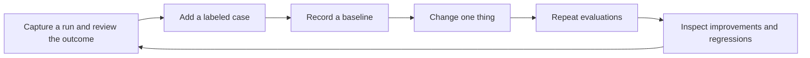

An agent's **trajectory** is the sequence of observable decisions and actions it
takes while working on a task. Two runs can give the same correct answer through
different trajectories.

```text
Path A: fetch sales -> analyze results -> answer
Path B: fetch sales -> analyze results -> fetch the same sales -> analyze again -> answer
```

If the extra fetch and analysis add nothing, Path B is doing unnecessary work.
But extra steps are not automatically waste: checking a result, fetching a missing
page, or recovering from a temporary failure can be necessary.

## Check success before efficiency

Evaluate the task outcome alongside the path. A quick wrong answer or a run that
stops early is not better because it used fewer calls.

Useful questions include:

- Did the run finish the requested task using appropriate evidence?
- Were repeated calls needed for progress or recovery?
- Did a wrong tool or parameter cause the agent to revisit earlier work?
- Did it finish within the application's work limits?

Several paths can be valid. Prefer explicit task requirements and acceptable
behavior over insisting that every run match one reference sequence.

## What the repository calls convergence

`loopguard.evals.convergence_score()` compares positive step counts with the
shortest count in the supplied list. For each run it divides that baseline by
the run's count, then averages the ratios:

```text
baseline = shortest positive count supplied
per-run ratio = min(1, baseline / run_steps)
score = average of the per-run ratios
```

This is a relative step-count score used by the repository's evaluation helpers.
It is not a proof of convergence or a universal standard for evaluating agents.
The shortest observed path is not necessarily the best possible path.

## Work through an example

Suppose three comparable, successful runs take 5, 10, and 20 steps. These are
illustrative inputs, not measured LoopGuard benchmark results.

| Run steps | Ratio to the five-step baseline |
| --- | --- |
| `5` | `1.00` |
| `10` | `0.50` |
| `20` | `0.25` |

The average is approximately `0.58`. Run the helper without a model or API key:

```python
from loopguard.evals import convergence_score

successful_step_counts = [5, 10, 20]
print(f"{convergence_score(successful_step_counts):.2f}")
```

```text
0.58
```

The function receives only counts. It does not check task success, labels, or tool
correctness. Select comparable successful runs yourself and report failed or
interrupted runs separately. Otherwise a short failed run can become the baseline
and distort the comparison.

The implementation ignores nonpositive counts and returns `0.0` if none remain.
Keep track of missing runs and failures rather than silently dropping them from
your evaluation report.

## Use consistent counting

Choose one definition of a step before comparing runs. A tool call and its result
can be two LoopGuard events. A saved export can instead store both in one step.
Mixing those counts makes the comparison misleading.

Group similar tasks and conditions together. A run fetching ten pages should not
be judged against a one-page task just because both use a search tool.

Also preserve a baseline when comparing versions. The helper recomputes the
shortest count for each supplied list: `[5, 5]` and `[20, 20]` both score `1.0`.
That does not mean the second version is equally efficient. Review raw counts and
task outcomes alongside the relative score.

Step counts do not measure latency, tokens, or cost. Collect those separately if
they matter to the application.

## Turn an observed failure into an evaluation case

Your agent may return a good-looking sales summary after querying incomplete data.
A LoopGuard report can help expose repeated work, but checking the data source and
answer still needs application-specific evaluation.

A useful case records the request, relevant input state, observed trace, expected
outcome, and the particular failure to prevent. For stuck-run checks, include both
healthy repetition and unhealthy repetition in the dataset.

The repository already has examples of healthy polling, retry recovery, pagination,
empty-result loops, permanent failures, and action/handoff cycles in
[`examples/v02_labeled_traces.json`](https://github.com/mahimathacker/loopguard/blob/master/examples/v02_labeled_traces.json).
Its `expected_decision` fields describe policy expectations, not final-answer quality.

## Treat changes as experiments



Run the same cases before and after a prompt, model, tool, memory, or detection
change. Preserve the relevant settings so the comparison is meaningful. For
model-backed runs, consider repeated trials rather than trusting a single success.
Inspect the failed cases as well as aggregate scores.

User feedback and observed failures can supply new cases, but review and label
them before treating them as expected outcomes. Keep task success, answer quality,
and path checks distinct so a better-written answer doesn't hide a tool regression.
For more on task, trial, and grader design, see
[Anthropic's agent evaluation guide](https://www.anthropic.com/research/demystifying-evals-for-ai-agents).

This is an application workflow you build around LoopGuard's reports. The SDK does
not automatically collect feedback, manage an experiment store, or maintain your
evaluation dataset. Its [trace check command](/guides/saved-traces#fail-a-script-or-ci-check)
can supply pass/fail behavior for the stuck-run part of a CI check.

[Run the existing evaluations](/development/evaluation) or
[inspect a saved trace](/guides/saved-traces).
