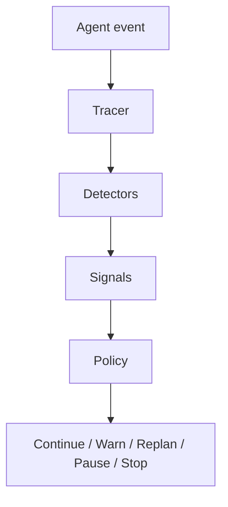

LoopGuard separates what happened from what the application should do about it.
A repeated call is evidence. Stopping the run is a policy decision.

For the broader agent cycle, start with [AI agents and loops](/concepts/agents-and-loops).
For the difference between a runtime decision and an evaluation, see
[tests, traces, and evals](/concepts/tests-traces-and-evals).



## Record what happened

The tracer stores ordered events. A tool call and its returned result are separate
events, so three tool calls can produce six recorded events.

An **event** describes one observation: which node acted, what it did, its normalized
signature, and any attached details. For example, a search call might produce a
`tool:search(query=pricing)` signature, followed by `result:no results`.

Live callbacks record tool starts, tool results, and tool errors. They do not record
every token, thought, or arbitrary graph node.

## Collect evidence

Detectors inspect the new event and the trace so far. A **signal** describes a
finding, such as a repeated tool call, unchanged output, or a permanent failure.
It includes a score and the evidence behind the finding.

Consider these two runs:

```text
poll job -> pending
poll job -> processing
poll job -> completed
```

```text
search -> no results
search -> no results
search -> no results
```

Both repeat an action. The first returns new information; the second doesn't.
LoopGuard compares recorded output signatures and uses simple text heuristics.
It does not prove whether the agent has achieved a business goal.

## Make a decision

A **decision** combines signals into an action, a risk score, and reasons.
The default policy can produce:

| Action | Current behavior |
| --- | --- |
| `continue` | Keep running. |
| `warn` | Record evidence worth inspecting. |
| `replan` | Record a recommendation to change approach. |
| `pause` | Record a recommendation to pause for review. |
| `stop` | Request interruption through the active integration. |

<Note>
`REPLAN` and `PAUSE` do not rewrite the plan or suspend execution. Your application
must act on those recommendations. Observe-only mode also records `STOP` without
raising an interrupt.
</Note>

With the default policy, exact repetition alone produces a warning. Repetition or
an action cycle combined with no-progress evidence can reach `STOP`. Repeated
permanent failures, repeated closed handoff cycles, and exceeded budgets can also
reach `STOP`.

The monitor retains recent signals. When new evidence fires, the policy considers
up to the last 12 signals. An event with no new signal gets a `continue` decision;
an earlier `STOP` still makes the run's interruption flag true.

## Enforce the decision

The callback handler raises `LoopGuardInterrupt` on `STOP` when interruption is
enabled. The surrounding framework must let that exception propagate.

The stream wrapper checks the monitor after a streamed update and stops consuming
the stream at `STOP`. This does not undo completed tool calls or cancel external
work that a tool has already started.

Saved-trace analysis replays the entire export. It reports where `STOP` would have
occurred without rerunning or interrupting the original agent.
